# 数字内容安全实验一：基于Logistic混沌序列的图像加密算法分析实验报告

## 摘要

本实验用 Python 实现 Logistic 序列生成、归一化数值映射与 8 位整数化、图像异或加密与解密，并对 20 张图像进行测试。15 张内容图用于统计加密效果和运行性能，5 张控制图用于观察特殊输入的影响。另以一张漫画/CG 图像展示加密过程，并在 7 个参数取值下分析结果变化。内容图的密文熵均值为 7.9669 bit/像素，三方向邻接相关系数绝对值均值为 0.001165，15 张图均能逐字节准确解密。单比特扰动实验中，每张图只有 1 个密文字节改变，表明当前逐字节异或结构缺少跨像素扩散。

## 1. 实验目的

1. 理解 Logistic 映射生成图像掩码的过程，准确实现逐字节 XOR 加解密。
2. 用多种内容图和控制图评估密文分布、空间相关、可逆性、差分响应与运行性能。
3. 通过典型图像和参数变化实验，分析指标之间的联系及算法的适用范围。

## 2. 算法原理与实现

设预处理后的 8 位灰度图像按行优先顺序展开为 $I_1,I_2,\ldots,I_N$。本实验取 $N=512\times512=262144$，Logistic 序列和掩码字节的定义为

$$
x_{k+1}=u x_k(1-x_k),\qquad
P_k=\left\lfloor255x_k\right\rfloor,\quad k=1,2,\ldots,N.
$$
其中 $0<x_0<1$，本实验参数范围为 $3.5699456<u\leq4$。本实验固定舍弃迭代次数 `burn_in=0`，所以首个掩码字节 $P_1$ 由归一化序列值 $x_1$ 乘以 255 后向下取整得到。

加密和解密均使用同一掩码：

$$
C_k=I_k\oplus P_k,\qquad I_k=C_k\oplus P_k,\quad k=1,2,\ldots,N.
$$

其中 $\oplus$ 是 8 位字节的逐位异或。$P$ 与输入图像具有相同的空间分辨率；算法逐位置改变像素值，没有调整像素坐标。课件中的“缩放后取整”在代码中明确为 $\lfloor255x\rfloor$。

测试命令采用 `--mode L`。原始样例为 RGB PNG，程序读入后先转为 8 位灰度图，再进行加密。因此，解密结果应与灰度预处理后的输入逐字节比较。密文和恢复图均保存为无损 PNG。

## 3. 数据与实验方法

### 3.1 测试图像和运行环境

样例集共有 20 张 $512\times512$ 图像。内容组包括漫画、自然景观、城市、人物、动物、食物和纹理等 15 张图；控制组包括全黑、水平渐变、棋盘格、均匀噪声和文字页面 5 张图。编号 01 的漫画/CG 图片由本人提供。

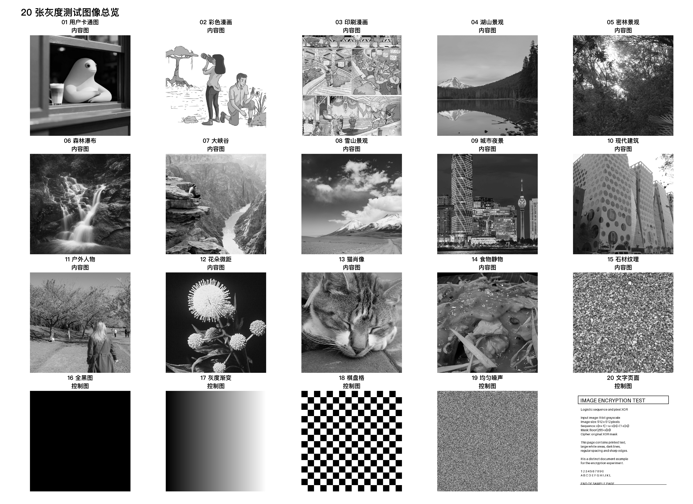

*图 1　20 张测试图转为灰度后的总览；图像编号与附录 A 一致。*

结果统计：样例集包括 15 张内容图和 5 张控制图，图像尺寸均为 512 × 512 像素。

实验使用 Conda 环境 `logistic-image`，配置文件指定 Python 3.12、NumPy、Pillow 和 Matplotlib。定量实验及第 5.1 节的典型图像实验固定 $x_0=0.3141592653589793$、$u=4.0$、`burn_in=0`；第 5.2 节固定 $x_0$ 和 `burn_in`，单独改变 $u$。每张图先进行 1 次不计时预热，然后对加密或解密变换重复 3 次，取中位耗时。计时包括掩码生成与 XOR，不包括文件读写、指标计算和绘图。各项批量统计对图像求算术平均值与样本标准差；标准差反映不同样例之间的差异。

### 3.2 评测指标

| 指标 | 计算含义 | 本实验中的作用 |
| --- | --- | --- |
| 信息熵 $H$ | $-\sum_{v=0}^{255}p(v)\log_2p(v)$，单位 bit/像素；8 位灰度图上限为 8 | 描述灰度级分布的离散程度；密文熵接近 8 时，其直方图通常更分散。 |
| 直方图 TV 距离 | $\tfrac12\sum_{v=0}^{255}\lvert p(v)-1/256\rvert$，无量纲 | 衡量灰度直方图与 256 级均匀分布的差距；数值越接近 0，直方图越均匀。 |
| 邻接像素相关系数 $r$ | 相邻像素对灰度值的 Pearson 相关，分别计算水平、垂直和右下对角方向；范围 $[-1,1]$ | 衡量局部线性关系。批量表格先取各方向 $\lvert r\rvert$ 再求平均；典型图像表格保留相关系数的正负号。常数图的原图相关系数无定义。 |
| 均方误差 MSE | $\operatorname{mean}[(I-C)^2]$，单位灰度级平方 | 描述原图和密文的像素数值差异，辅助说明外观改变程度。 |
| 峰值信噪比 PSNR | $10\log_{10}(255^2/\mathrm{MSE})$，单位 dB | 与 MSE 一同描述原图和密文的外观差异；本实验用于典型图像。 |
| NPCR | $100\times\operatorname{card}\{k\mid C_k\ne C'_k\}/N$，单位 % | 测量明文中心字节最低位翻转后，密文有多少字节发生改变，反映变化的传播范围。 |
| UACI | $100\times\operatorname{mean}(\lvert C-C'\rvert/255)$，单位 % | 测量同一次明文扰动引起的密文字节变化幅度。 |
| 加解密耗时 | 预热后 3 次变换的中位数，单位 ms | 评估本机运行性能。 |
| 吞吐量 | 通道字节数除以变换时间，单位 MiB/s | 将处理速度换算为每秒处理的数据量。 |
| 精确恢复 | 解密结果与灰度预处理后的输入逐字节相同 | 验证算法实现的可逆性。 |

NPCR、UACI 比较的是原密文 $C$ 与扰动后密文 $C'$。MSE、PSNR 比较的是原图 $I$ 与密文 $C$。这两类比较的对象不同，分析时分别使用。信息熵、TV 距离和邻接相关描述密文的统计特征，差分指标描述明文变化在密文中的传播情况。

## 4. 定量实验：20 张图像的统计结果

### 4.1 内容图与控制图的汇总

表 1 中“均值 ± 标准差”先对每张图计算指标，再在组内汇总。内容组 $n=15$，控制组 $n=5$。全黑图的原图邻接相关系数无定义，控制组该项统计使用其余 4 张图。

| 指标 | 15 张内容图：均值 ± 标准差 | 5 张控制图：均值 ± 标准差 |
| --- | ---: | ---: |
| 原图熵（bit/像素） | 7.0526 ± 1.1502 | 3.5649 ± 4.0659 |
| 密文熵（bit/像素） | 7.9669 ± 0.0391 | 7.8248 ± 0.1602 |
| 原图直方图 TV | 0.38861 ± 0.14724 | 0.58880 ± 0.53187 |
| 密文直方图 TV | 0.07752 ± 0.03008 | 0.12863 ± 0.10625 |
| 原图三方向平均 $\lvert r\rvert$ | 0.88853 ± 0.11650 | 0.63262 ± 0.45344（$n=4$） |
| 密文三方向平均 $\lvert r\rvert$ | 0.001165 ± 0.000434 | 0.001194 ± 0.000604 |
| 原图与密文 MSE（灰度级平方） | 10121.95 ± 3449.48 | 18790.41 ± 7216.61 |
| 加密耗时（ms） | 10.330 ± 0.218 | 10.541 ± 0.275 |
| 解密耗时（ms） | 10.335 ± 0.287 | 10.432 ± 0.083 |
| 加密吞吐量（MiB/s） | 24.211 ± 0.508 | 23.730 ± 0.603 |
| 解密吞吐量（MiB/s） | 24.207 ± 0.659 | 23.967 ± 0.188 |
| NPCR（%） | 0.0003814697 ± 0 | 0.0003814697 ± 0 |
| UACI（%） | $1.4959597\times10^{-6}$ ± 0 | $1.4959597\times10^{-6}$ ± 0 |
| 精确恢复 | 15/15 | 5/5 |

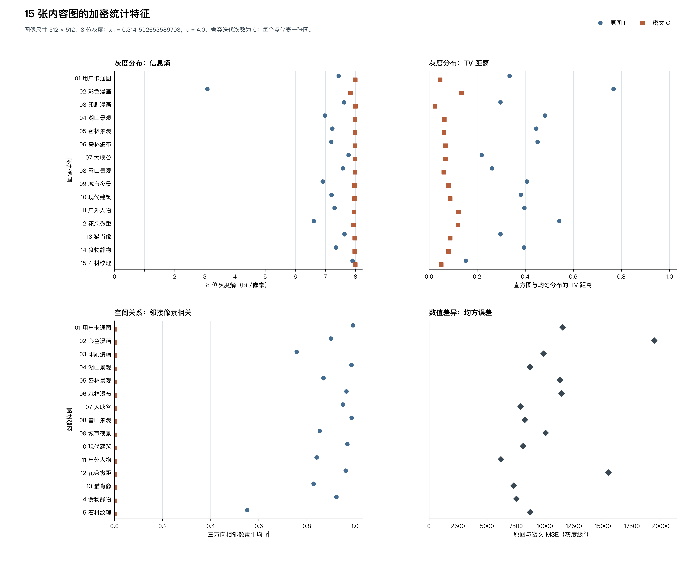

*图 2　15 张内容图的信息熵、直方图 TV 距离、邻接像素相关和 MSE。纵轴为图像样例，横轴为各子图对应指标；圆点表示原图，方点表示密文。*

结果统计：密文熵为 7.9669 ± 0.0391 bit/像素，TV 距离为 0.07752 ± 0.03008，三方向平均 |r| 为 0.001165 ± 0.000434，原图与密文 MSE 为 10121.95 ± 3449.48 灰度级²。

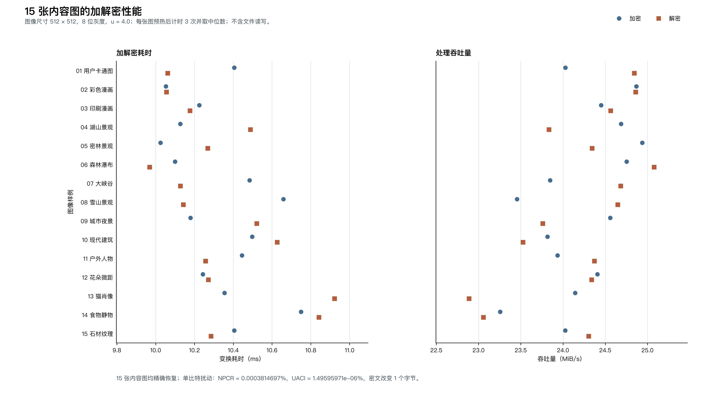

*图 3　15 张内容图的加解密耗时与吞吐量。纵轴为图像样例，横轴为耗时（ms）或吞吐量（MiB/s）；每个点对应预热后 3 次计时的中位数。*

结果统计：平均加密耗时为 10.330 ± 0.218 ms，平均解密耗时为 10.335 ± 0.287 ms；加密、解密吞吐量分别为 24.211 ± 0.508 和 24.207 ± 0.659 MiB/s。15 张图均精确恢复；单比特扰动的 NPCR 为 0.0003814697%，UACI 为 1.4959597 × 10⁻⁶%。

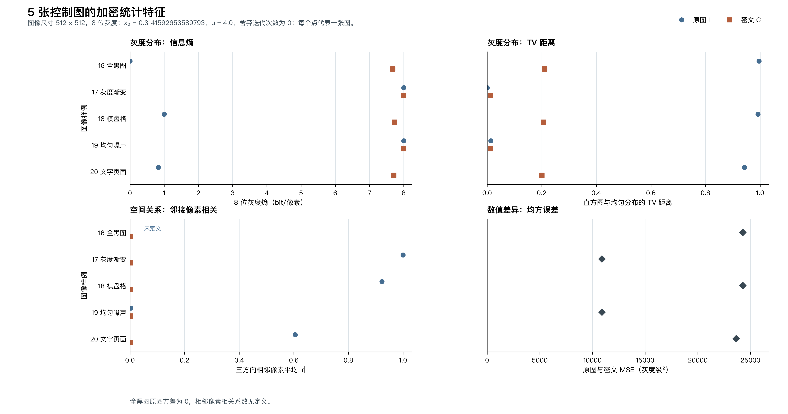

*图 4　5 张控制图的信息熵、直方图 TV 距离、邻接像素相关和 MSE。纵轴为图像样例，横轴为各子图对应指标；全黑图的原图相关系数显示为未定义。*

结果统计：控制图密文熵为 7.8248 ± 0.1602 bit/像素，TV 距离为 0.12863 ± 0.10625，三方向平均 |r| 为 0.001194 ± 0.000604。全黑图原图方差为 0，因此其邻接相关系数未定义。

内容图的原图熵差别较大，彩色漫画转灰度后的熵只有 3.0805 bit/像素。加密后，15 张内容图的密文熵介于 7.8400 和 7.9972 bit/像素。密文的平均直方图 TV 距离为 0.07752，平均三方向邻接 $\lvert r\rvert$ 为 0.001165；图 2 中的密文点主要分布在较高熵、较低 TV 与较低线性相关的区域。

控制图展示了输入分布的影响。全黑图满足 $I_k=0$，因此其密文就是掩码 $P$；该图的密文熵为 7.6819，TV 距离为 0.21106。水平渐变图的密文熵达到 7.9994，TV 距离为 0.01166。20 张图均使用相同尺寸及同一组 $x_0,u$ 参数，这些差异说明固定掩码异或后的密文直方图会随输入内容变化。

内容图平均加密时间为 10.330 ms，平均吞吐量为 24.211 MiB/s。全部样例均能精确恢复。明文中心字节翻转最低位后，每张图只有 1 个密文字节变化，因此两组的 NPCR 和 UACI 均相同。逐图主要数值见附录 A。

## 5. 定性实验：典型图像与参数变化

### 5.1 典型图像的加密表现

选取编号 01 的漫画/CG 图片。它包含大块平滑区域、主体轮廓、窗框边缘及背景纹理，适合观察不同区域的变化。图 5 中原图与恢复图一致，掩码和密文呈颗粒状纹理，密文中难以辨认原有主体。

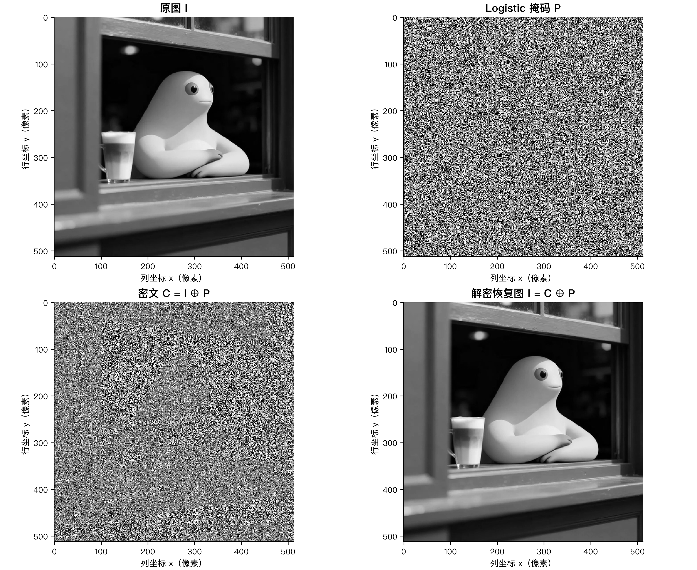

*图 5　典型图像的原图 $I$、掩码 $P$、密文 $C$ 和恢复图；横轴为列坐标 $x$（像素），纵轴为行坐标 $y$（像素）。*

结果统计：四幅图的尺寸均为 512 × 512 像素；恢复图与灰度原图逐像素一致，错误字节数为 0。

**表 2　典型图像的分布和邻接相关指标**

| 图像 | 熵（bit/像素） | TV 距离 | 水平 $r$ | 垂直 $r$ | 对角 $r$ |
| --- | ---: | ---: | ---: | ---: | ---: |
| 原图 $I$ | 7.440360 | 0.334911 | 0.995378 | 0.990889 | 0.988167 |
| 掩码 $P$ | 7.681950 | 0.211060 | 0.000508 | 0.001501 | −0.000481 |
| 密文 $C$ | 7.991385 | 0.046154 | −0.000384 | 0.002264 | −0.000135 |

原图与密文的 MSE 为 **11526.8711** 灰度级平方，PSNR 为 **7.5137 dB**，两者有 **96.0430%** 的字节取值不同。恢复图与灰度原图之间的错误字节数为 **0**。

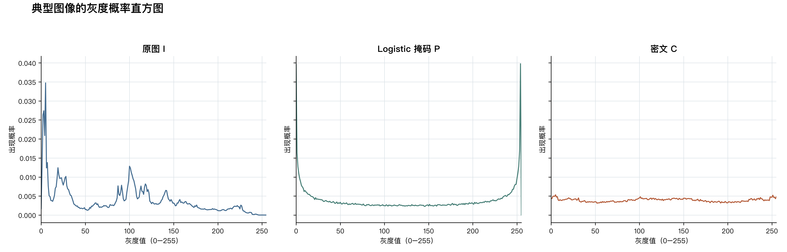

*图 6　原图、Logistic 掩码与密文的概率直方图。横轴为灰度值（0—255），纵轴为对应灰度值的出现概率。*

结果统计：原图、掩码和密文熵分别为 7.4404、7.6820 和 7.9914 bit/像素；对应 TV 距离分别为 0.33491、0.21106 和 0.04615。

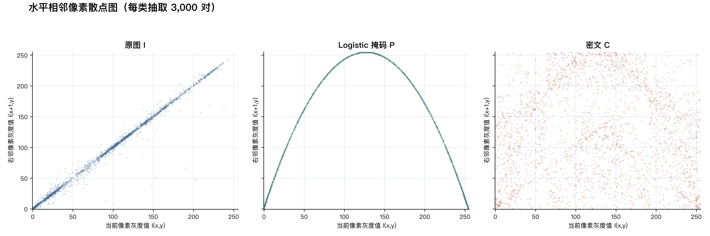

*图 7　从相同位置抽取的 3000 对水平相邻像素。横轴为当前像素灰度值 $I(x,y)$，纵轴为右邻像素灰度值 $I(x+1,y)$，范围均为 0—255。*

结果统计：原图、掩码和密文的水平 Pearson 相关系数分别为 0.995378、0.000508 和 −0.000384。掩码散点仍呈弧线，显示 Pearson 系数无法单独描述其中的非线性关系。

图 7 的掩码弧线值得关注。它来自 Logistic 迭代中的非线性相邻项关系。掩码的水平 Pearson 相关系数接近 0，但散点图仍呈现明确形状。这说明单一的线性相关系数无法概括所有空间依赖。

将原图中心 $(x,y)=(256,256)$ 的最低位翻转后重新加密，密文中只有同一位置的 1 个字节发生变化。对应 NPCR 为 **0.0003814697%**，UACI 为 **$1.4959597\times10^{-6}$%**。图 8 的局部放大图清楚显示了这一位置。

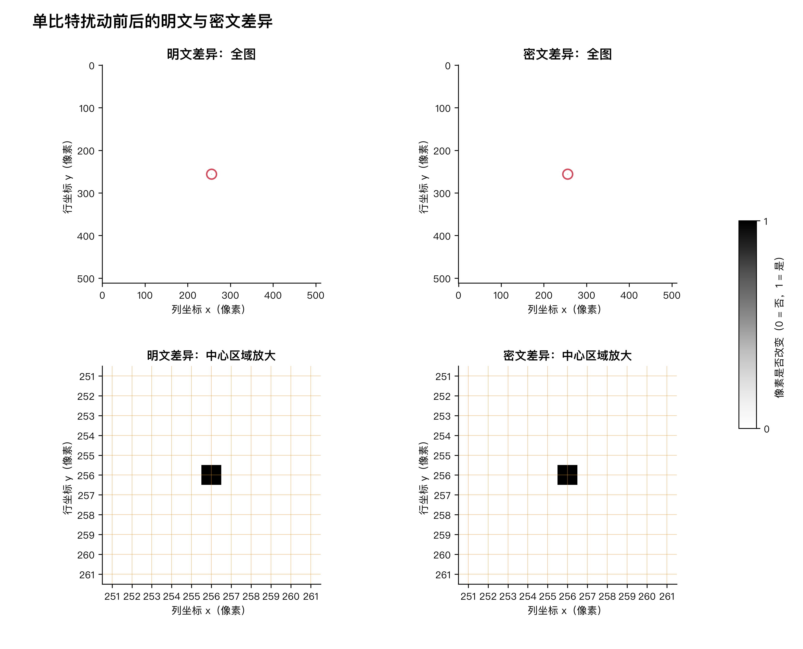

*图 8　扰动前后的明文、密文差异；横轴为列坐标，纵轴为行坐标，色标 0 表示未改变、1 表示改变。下排为中心区域放大图。*

结果统计：翻转明文中心位置（x，y）=（256，256）的最低位后，明文和密文各改变 1 个像素字节；NPCR 为 0.0003814697%，UACI 为 1.4959597 × 10⁻⁶%。

### 5.2 参数 $u$ 对典型图像的影响

固定编号 01 图像、$x_0=0.3141592653589793$、`burn_in=0` 和 8 位灰度模式，仅改变 $u$，分别取 $3.57,3.60,3.70,3.80,3.90,3.99,4.00$。对每个参数点计算密文熵、密文直方图 TV 距离、密文水平邻接相关系数绝对值和加密耗时四项指标。表 3 同时列出掩码熵与掩码 TV，便于比较掩码和密文的分布。所有取值都能精确恢复原图。

**表 3　参数 $u$ 对典型图像统计指标的影响**

| $u$ | 掩码熵（bit/像素） | 密文熵（bit/像素） | 掩码 TV | 密文 TV | 密文水平 $\lvert r\rvert$ | 加密耗时（ms） |
| ---: | ---: | ---: | ---: | ---: | ---: | ---: |
| 3.57 | 4.4271 | 7.9398 | 0.89573 | 0.11776 | 0.26004 | 10.617 |
| 3.60 | 6.3074 | 7.9536 | 0.62012 | 0.09783 | 0.31591 | 10.454 |
| 3.70 | 7.0674 | 7.9353 | 0.42590 | 0.13141 | 0.00139 | 10.541 |
| 3.80 | 7.3618 | 7.9593 | 0.33843 | 0.10483 | 0.15634 | 10.532 |
| 3.90 | 7.4646 | 7.9845 | 0.30139 | 0.05272 | 0.25360 | 10.554 |
| 3.99 | 7.7642 | 7.9930 | 0.18901 | 0.04008 | 0.07312 | 10.659 |
| 4.00 | 7.6819 | 7.9914 | 0.21106 | 0.04615 | 0.00038 | 10.532 |

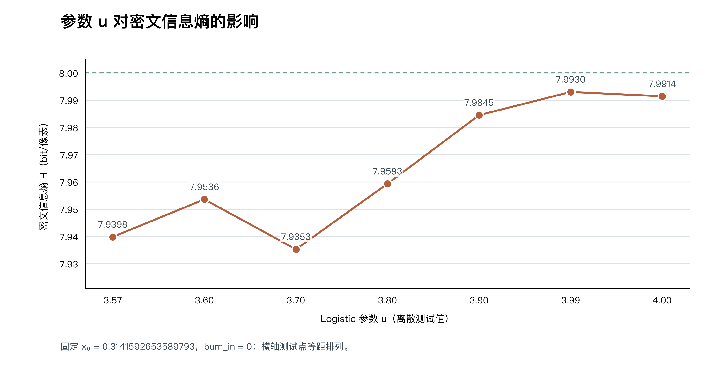

*图 9　参数 $u$ 与密文信息熵。横轴为 7 个等距排列的离散 $u$ 测试点，纵轴为密文信息熵（bit/像素）；虚线表示 8 位灰度图的熵上限 8。*

结果统计：密文熵在 $u=3.99$ 时最高，为 7.9930 bit/像素；在 $u=3.70$ 时最低，为 7.9353 bit/像素。$u=4.00$ 对应 7.9914 bit/像素。

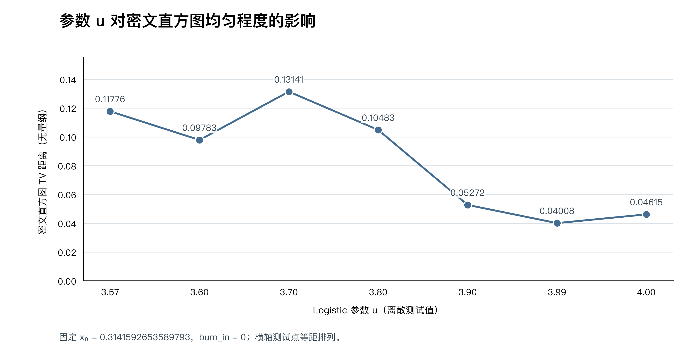

*图 10　参数 $u$ 与密文直方图 TV 距离。横轴为 7 个等距排列的离散 $u$ 测试点，纵轴为 TV 距离（无量纲）；数值越小，灰度直方图越接近均匀分布。*

结果统计：密文 TV 距离在 $u=3.99$ 时最低，为 0.04008；在 $u=3.70$ 时最高，为 0.13141。$u=4.00$ 对应 0.04615。

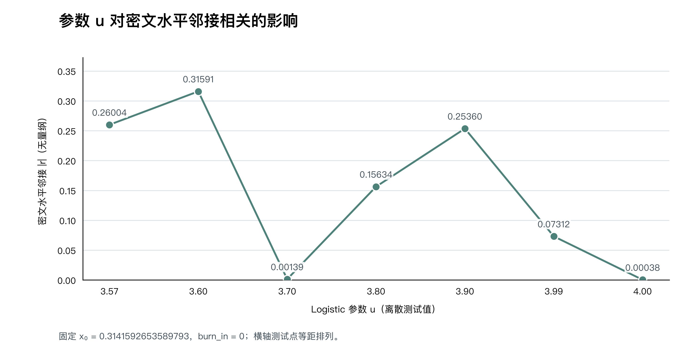

*图 11　参数 $u$ 与密文水平相邻像素的 Pearson 相关系数绝对值。横轴为 7 个等距排列的离散 $u$ 测试点，纵轴为 $|r|$（无量纲）。*

结果统计：$u=4.00$ 时 $|r|$ 最低，为 0.00038；$u=3.60$ 时最高，为 0.31591。$u=3.70$ 时也较低，为 0.00139。

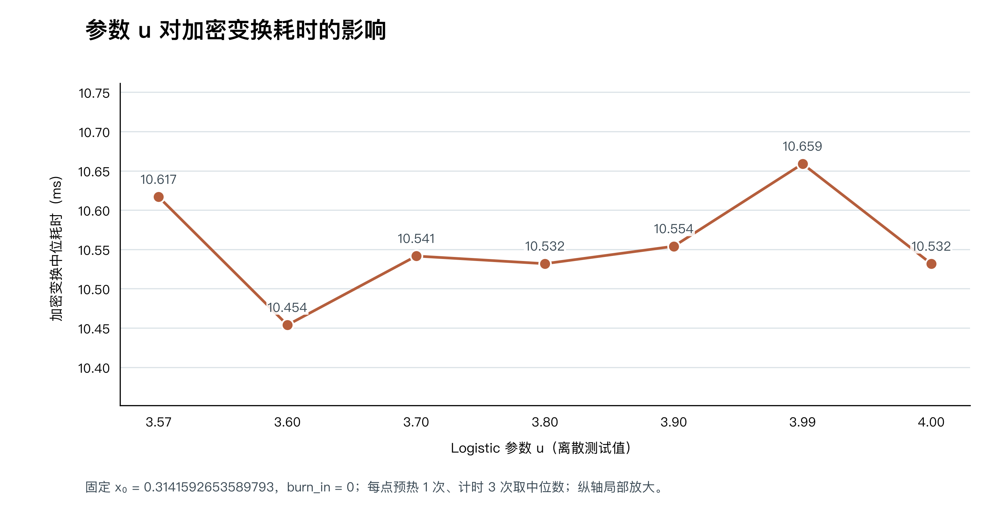

*图 12　参数 $u$ 与加密变换耗时。横轴为 7 个等距排列的离散 $u$ 测试点，纵轴为掩码生成及异或运算的耗时（ms）；每点预热 1 次，正式计时 3 次后取中位数，纵轴采用局部刻度。*

结果统计：7 个参数点的加密耗时介于 10.454—10.659 ms，最大与最小值相差 0.205 ms。7 组密文均能逐字节精确解密。

密文熵、TV 距离与水平邻接 $|r|$ 在各参数点的变化并不一致。$u=3.99$ 的熵和 TV 距离在这 7 个取值中表现较好，$u=4.00$ 的水平邻接 $|r|$ 更低。耗时差异较小，当前每点 3 次计时不足以判断它与 $u$ 的稳定关系。这些结论只覆盖本图像和本次选取的 7 个参数点。

## 6. 疑问与思考

### 6.1 密文熵接近 8，为什么单比特扰动只影响一个位置？

熵统计的是一幅图中灰度值的分布，NPCR 和 UACI 考察两次加密之间的变化传播。当前算法采用同一掩码逐位置异或，因此 $C'_k\oplus C_k=I'_k\oplus I_k$。若明文只有 1 个字节的最低位变化，密文也只有该字节变化。对 262144 字节的灰度图，理论上 $\mathrm{NPCR}=100/262144=0.0003814697\%$，$\mathrm{UACI}=100/(255\times262144)=1.4959597\times10^{-6}\%$；实验结果与推导一致。由此可见，熵与差分响应反映的是不同性质。

### 6.2 掩码邻接相关系数接近零，为什么散点图中还有弧线？

Pearson 系数主要反映线性关系。Logistic 相邻项由 $x_{k+1}=u x_k(1-x_k)$ 决定，呈非线性曲线。映射为 8 位整数后，这种关系仍在图 7 的邻接散点中保留下来。因此，分析序列时还应结合散点图和其他非线性统计方法。只看一个相关系数会遗漏结构信息。

### 6.3 同一组参数下，为什么不同图像的密文熵有差别？

20 张图像的尺寸相同，使用相同的 $x_0$ 和 $u$，因此对应的掩码字节流相同。输入图像的灰度分布不同，异或后的直方图也会变化。全黑图的密文恰好等于掩码，熵为 7.6819；均匀噪声图的密文熵为 7.9992。控制组有助于观察掩码统计和输入内容共同产生的结果。

### 6.4 重复使用同一组参数加密多张图会怎样？

对相同尺寸、相同参数生成的两个密文，有 $C^{(1)}\oplus C^{(2)}=I^{(1)}\oplus I^{(2)}$。如果知道一张原图及对应密文，还可以算出该位置的掩码 $P=I\oplus C$。这说明重复使用掩码会泄露图像间的信息。若面向实际保密应用，需要考虑每张图使用独立掩码，并引入经过安全分析的密钥流生成方式与跨像素扩散结构。

### 6.5 怎样进一步研究参数 $u$ 的影响？

本次只在一张图上测试 7 个取值。$u=3.99$ 的密文熵略高于 $u=4.00$，但水平相关系数也更高。后续可增加参数采样密度、更换初值与测试图像，并重复运行以分离时间波动。密文熵、TV 距离、水平邻接 $|r|$ 和耗时分别描述分布、空间关系及实现性能；增加参数采样点有助于观察局部变化。

## 7. 结论

本实验实现了课件所示的 Logistic 序列生成、归一化数值映射与图像异或处理，20 张灰度测试图均准确解密。内容组的密文在熵、直方图均匀程度和线性邻接相关方面呈现明显变化，平均加密时间约为 10.33 ms。典型图像和单比特扰动实验表明，当前结构的明文变化只传到相同位置的密文字节。参数实验显示，不同统计指标对 $u$ 的响应各有差异。图像加密效果的讨论需要同时覆盖分布、空间关系、差分响应、可逆性和运行性能。

## 附录 A：逐图主要数据

表 A1/A2 为逐图核心指标，数值按原始结果四舍五入。密文三向平均 $\lvert r\rvert$ 的计算方式是先取水平、垂直、对角方向的相关系数绝对值，再对三个方向平均。20 张图的 NPCR 均为 0.0003814697%，UACI 均为 $1.4959597\times10^{-6}$%，均精确恢复。

**表 A1　15 张内容图**

| 编号 | 内容 | 原图熵 | 密文熵 | 密文 TV | 密文三向平均 $\lvert r\rvert$ | MSE | 加密时间（ms） |
| ---: | --- | ---: | ---: | ---: | ---: | ---: | ---: |
| 01 | 漫画/CG | 7.4404 | 7.9914 | 0.04615 | 0.000928 | 11526.87 | 10.405 |
| 02 | 彩色漫画 | 3.0805 | 7.8400 | 0.13402 | 0.001278 | 19421.06 | 10.053 |
| 03 | 印刷漫画 | 7.6205 | 7.9972 | 0.02487 | 0.000998 | 9872.71 | 10.225 |
| 04 | 湖山景观 | 6.9805 | 7.9822 | 0.06345 | 0.001604 | 8697.70 | 10.127 |
| 05 | 密林景观 | 7.2272 | 7.9843 | 0.06276 | 0.001490 | 11296.57 | 10.025 |
| 06 | 瀑布景观 | 7.1930 | 7.9835 | 0.06873 | 0.000560 | 11438.97 | 10.099 |
| 07 | 峡谷景观 | 7.7664 | 7.9831 | 0.06841 | 0.000858 | 7901.05 | 10.484 |
| 08 | 雪山景观 | 7.5755 | 7.9839 | 0.06147 | 0.000630 | 8258.63 | 10.659 |
| 09 | 城市夜景 | 6.9079 | 7.9685 | 0.08087 | 0.001224 | 10045.39 | 10.180 |
| 10 | 现代建筑 | 7.2008 | 7.9686 | 0.08812 | 0.001679 | 8119.80 | 10.497 |
| 11 | 户外人物 | 7.3039 | 7.9504 | 0.12272 | 0.001159 | 6201.84 | 10.445 |
| 12 | 花朵微距 | 6.6170 | 7.9298 | 0.12054 | 0.001173 | 15470.41 | 10.243 |
| 13 | 动物肖像 | 7.6321 | 7.9738 | 0.08839 | 0.002073 | 7298.64 | 10.355 |
| 14 | 食物静物 | 7.3436 | 7.9768 | 0.08179 | 0.000539 | 7543.04 | 10.750 |
| 15 | 石材纹理 | 7.8995 | 7.9908 | 0.05048 | 0.001283 | 8736.63 | 10.405 |

**表 A2　5 张控制图**

| 编号 | 内容 | 原图熵 | 密文熵 | 密文 TV | 密文三向平均 $\lvert r\rvert$ | MSE | 加密时间（ms） |
| ---: | --- | ---: | ---: | ---: | ---: | ---: | ---: |
| 16 | 全黑 | 0.0000 | 7.6819 | 0.21106 | 0.000830 | 24267.54 | 10.313 |
| 17 | 水平渐变 | 8.0000 | 7.9994 | 0.01166 | 0.001472 | 10889.51 | 11.012 |
| 18 | 棋盘格 | 1.0000 | 7.7295 | 0.20704 | 0.000582 | 24267.54 | 10.486 |
| 19 | 均匀噪声 | 7.9992 | 7.9992 | 0.01297 | 0.002106 | 10890.59 | 10.509 |
| 20 | 文字页面 | 0.8254 | 7.7140 | 0.20045 | 0.000979 | 23636.88 | 10.384 |

